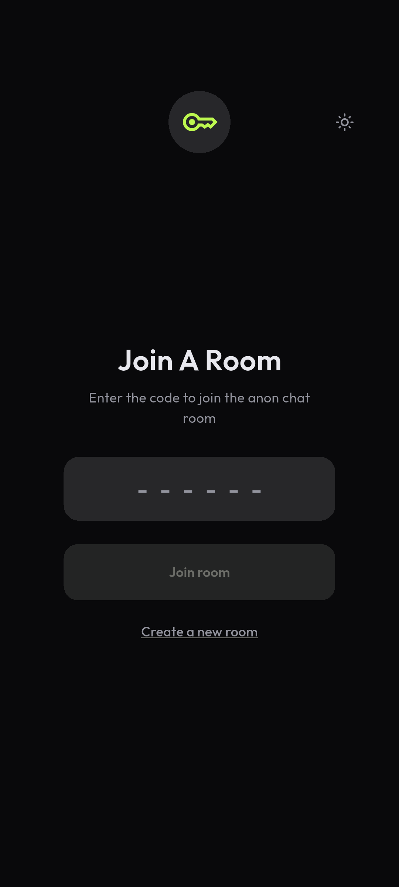
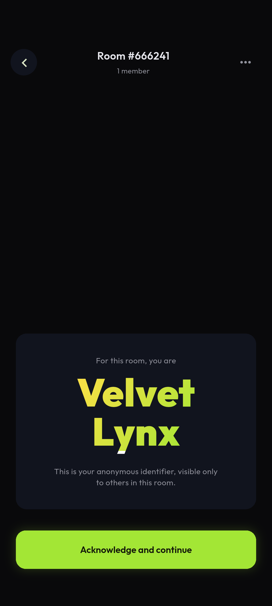
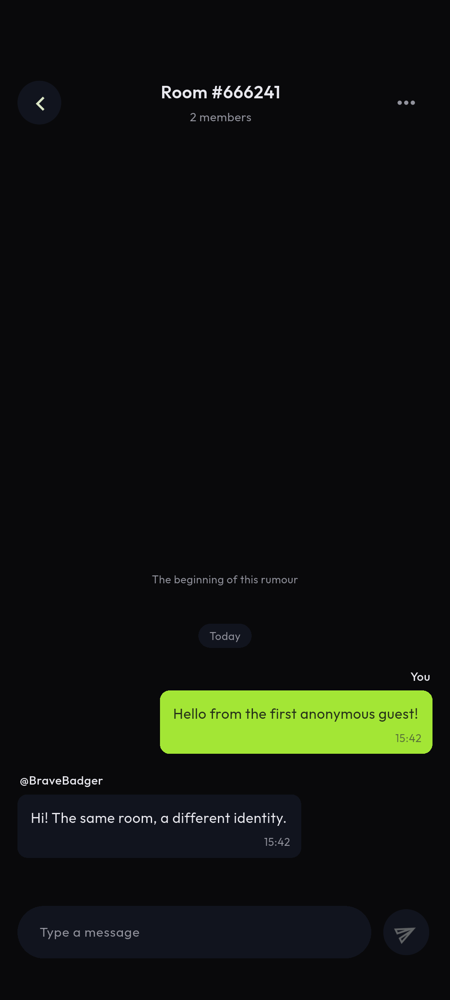

# Rumour · anonymous room chat

An Android app built with Flutter and Firebase Cloud Firestore for the VoiceClub coding task. Enter a six-digit room code or create a new room, meet your room-specific anonymous identity, and chat in real time.

[Download the APK · ARM64](artifacts/rumor-app.apk) · [Watch the complete workflow](artifacts/workflow.mp4) · [Firebase project](https://console.firebase.google.com/project/rumor-app-yatheendra97/overview)

Most current Android phones use the main ARM64 APK. Also available: [32-bit ARM](artifacts/rumor-app-armeabi-v7a.apk) and [x86_64 emulators](artifacts/rumor-app-x86_64.apk).

## Features

- Create a room with a cryptographically random six-digit invitation code; join an existing room with code validation and useful error states.
- Request a fresh identity seed from `GET https://randomuser.me/api/` for each new room. Its generated UUID maps deterministically to an adjective/animal pseudonym, matching the design's anonymous naming. No profile photo, email, or actual name is stored.
- Keep each room's identity on the device with SharedPreferences. Returning to a recent room reuses it. Firebase anonymous authentication persists the device's backend user ID.
- Receive messages and member counts through Firestore snapshots. Each message shows its sender, server-acknowledged time, and a date separator. Membership counts are joined identities, not online presence.
- Load the latest 30 messages, then page backward with Firestore document cursors. Already-loaded messages remain visible as the latest live window moves.
- Read previously loaded messages offline, including after reopening the app. Firestore's persistent disk cache and a per-room local archive preserve the loaded history. Offline writes display “Sending…” and receive a server timestamp after reconnection.
- Dark and light themes with a saved preference, room-code copying, selectable message text, and subtle screen transitions.
- App icon exported from the supplied Figma file. Dark canvas, lime accents, gradient identity card, compact bubbles, and layouts follow the three design screens. Room creation, recent rooms, theme controls, and explicit joining extend the design to cover the functional requirements.

## Run

Requirements: Flutter stable with Dart 3.11+, Android SDK, Java 17, and an Android device/emulator (API 23+). This project was created with Flutter 3.41.6; the Android build uses Kotlin 2.4.21 to support the current Firebase Android SDK.

```sh
flutter pub get
flutter run
```

The included `android/app/google-services.json` connects to `rumor-app-yatheendra97`. Firebase client configuration is intended to ship in the app; no service-account keys, admin credentials, or login tokens are in this repository. Access is enforced by `firestore.rules`.

To use another Firebase project, register Android package `com.yatheendra.rumor_app`, download its `google-services.json`, enable **Anonymous** Authentication, create a **Cloud Firestore** database, and deploy the rules:

```sh
firebase use YOUR_PROJECT_ID
firebase deploy --only firestore
```

The supplied project uses the Spark plan and a Firestore Standard database in `asia-south1`. It does not require a billing account.

## Codebase structure

```text
lib/
  main.dart                   Firebase startup, local settings, app/theme ownership
  models/chat_models.dart     Identity/message models, pseudonyms, date/code helpers
  data/
    local_store.dart          Room identities, recent rooms, durable chat archive
    room_repository.dart      Anonymous auth, randomuser API, room creation/joining
    chat_controller.dart      Realtime subscriptions, cursor pagination, queued sends
  ui/
    join_screen.dart          Code entry, create room, recent rooms
    room_screen.dart          Identity acknowledgement and chat conversation
    theme.dart                Colors, typography, exported Figma logo
assets/                       Bundled icon and Outfit font (with license)
firestore.rules               Membership-based authorization and write validation
test/                         Deterministic model and persistence tests
integration_test/             Android workflow against real Firebase with two clients
artifacts/                    Installable APK and workflow recording
```

The UI owns navigation and transient form state; `RoomRepository` owns onboarding and identity persistence; `ChatController` owns one room's live session. Subscriptions and controllers are disposed when leaving a room. A cached recent room can be reopened without contacting the identity API or the server.

## Firestore data structure

```text
rooms/{sixDigitCode}
  createdBy: string           Firebase anonymous UID
  createdAt: timestamp        server timestamp
  members/{anonymousUid}
    name: string              e.g. "Brave Badger"
    seed: string              randomuser login UUID
    joinedAt: timestamp       server timestamp
  messages/{autoId}
    senderId: string          Firebase anonymous UID
    name: string              immutable room pseudonym
    text: string              1–2000 characters
    createdAt: timestamp      authoritative server timestamp
    clientTime: timestamp     local ordering fallback while queued, not the displayed sent time
```

Messages are queried by `createdAt descending`, limited to 30, with `startAfterDocument` for older pages. A document-ID tie-breaker prevents unstable UI ordering when server timestamps coincide. No composite index is needed. The local archive merges messages by document ID so updates cannot create duplicate bubbles.

Rules allow authenticated guests to get a known room code, but deny listing all rooms. A guest can only create their own immutable membership. Message reads require membership; writes require the authenticated sender, their stored pseudonym, a bounded text payload, and a server timestamp. Message edits/deletes and room modifications are denied. A room code is a shareable invitation, not a high-entropy secret; this assignment implementation does not include production abuse throttling or moderation.

## Validation and build

```sh
dart format --output=none --set-exit-if-changed lib test integration_test
flutter analyze
flutter test
flutter test integration_test/workflow_test.dart -d emulator-5554
flutter build apk --release --split-per-abi
```

The integration test creates its own room in the configured Firebase project, uses an independent Firebase app as a second device, tests live replies and pagination beyond 30 messages, recreates the widget tree while offline, verifies identity reuse and queued message delivery, and checks that nonmembers, spoofed identities, and edits are rejected. Test-created rooms remain in the project for review.

The APKs are release-mode assessment builds signed with the Android debug key, suitable for direct installation. Use a private release signing key before publishing to a store. Android notifications are an optional assignment bonus and are not implemented; theme switching and animations are included.

## Screenshots





## Design reference

[Task brief](https://voiceclub.notion.site/Coding-Task-2c011f5b225e803a9decfb2164ba2d95) · [Figma](https://www.figma.com/design/IkTeb75W5kNVQhv0vPh5mz/Rumour-App?node-id=0-1)
